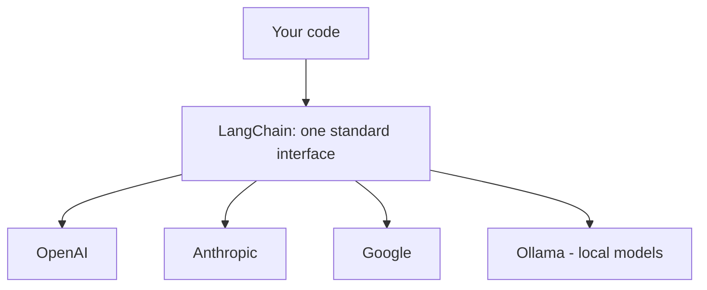

# What is LangChain?

**LangChain is a toolbox for building apps with LLMs.**

## The problem it solves

Every LLM company has its own API. OpenAI, Anthropic, Google and Ollama all take messages in a different shape and return answers in a different shape. If you write your app for one, switching to another means rewriting code.

## What LangChain gives you

1. **One way to talk to any LLM.** `llm.invoke(messages)` works the same for every provider. You change one setting (`MODEL` in `.env`), not your code.
2. **Messages.** Standard message types: `SystemMessage` (instructions), `HumanMessage` (the user), `AIMessage` (the model), `ToolMessage` (a tool's result).
3. **Tools.** The `@tool` decorator turns a normal Python function into something an LLM can ask to use.
4. **Building blocks for RAG.** Document loaders, text splitters, embeddings and vector stores.

## What we use from LangChain in this project

| We use | For |
|---|---|
| `init_chat_model("provider:model")` | Create the LLM from one string |
| `SystemMessage`, `HumanMessage`, `AIMessage`, `ToolMessage` | The conversation |
| `@tool` | Turn our Python functions into tools |
| `RecursiveCharacterTextSplitter` | Cut policy documents into chunks |
| `HuggingFaceEmbeddings` | Turn text into numbers |
| `InMemoryVectorStore` | Search chunks by meaning |

## In one sentence

LangChain gives you the **parts**: models, messages, tools and search. It does not decide the **order** in which they run. That's LangGraph's job.
