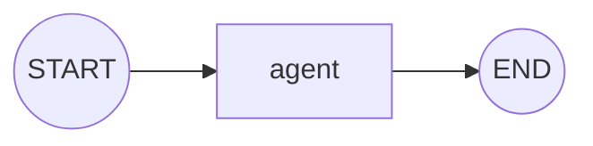
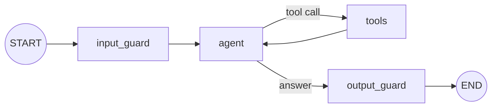

# What is LangGraph?

**LangGraph lets you draw your agent as a flowchart, then run it.**

## The idea

An agent is a series of steps: think, maybe use a tool, think again, answer. LangGraph describes those steps as a **graph**:

There are only three ideas:

| Idea | What it is | Example in our project |
|---|---|---|
| **State** | The data that flows through the graph | The list of messages in the conversation |
| **Node** | A box. A plain Python function that reads the state and returns an update | `agent`: calls the LLM |
| **Edge** | An arrow. It says which node runs next | `START → agent → END` |

A **conditional edge** is an arrow with a question: "Did the LLM ask for a tool? Go to `tools`. If not, go to `END`."

## Our agent grows one box at a time

- **v0** has one box: `agent`.
- **v1** adds `tools` and the loop between `agent` and `tools`.
- **v5** adds `input_guard` before the agent and `output_guard` after it.

## Extra powers we use

| Power | What it does | Used in |
|---|---|---|
| **Checkpointer** | Saves the state after every step, per conversation | v3 memory, v4 pause |
| **Store** | Saves facts across conversations | v3 long-term memory |
| **`interrupt()`** | Pauses the graph and waits for a human | v4 refunds |
| **Recursion limit** | Stops a graph that loops too long | v5 guardrails |

## LangChain vs LangGraph

| LangChain | LangGraph |
|---|---|
| The parts: LLMs, messages, tools, search | The flow: which part runs when |
| "What can I use?" | "In what order, and what if...?" |

They work together. Our nodes use LangChain parts inside. LangGraph connects the nodes.
