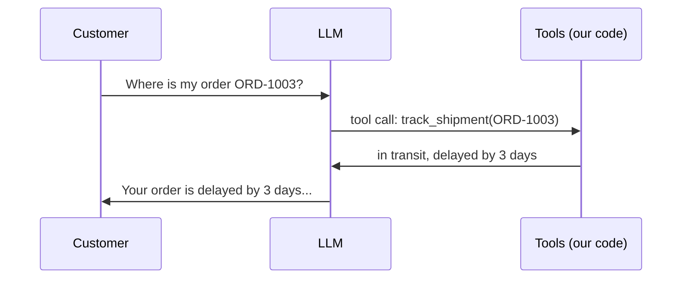
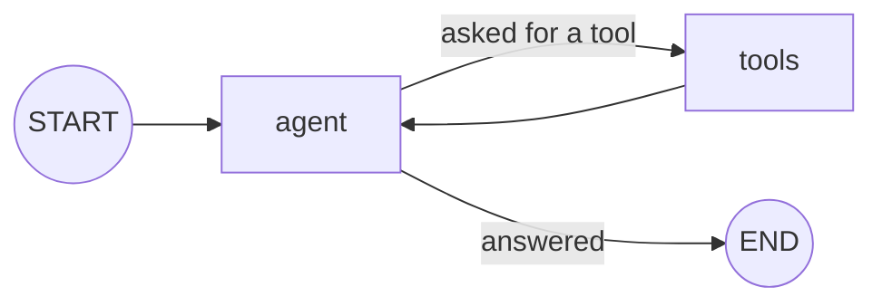

# Tools and the agent loop

## The problem

An LLM only knows what it learned in training. It has never seen our orders. Ask it "Where is my order ORD-1003?" and it can only guess.

## What is a tool?

**A tool is a normal Python function that the LLM can ask us to run.**

The LLM never runs code itself. It only writes a request: "please call `track_shipment` with `order_id = ORD-1003`". This request is called a **tool call**. Our code runs the function and gives the result back to the LLM.

The LLM decides which tool to call by reading each tool's **name** and **docstring**. A clear docstring is the most important part of a tool.

## The agent loop

1. The LLM reads the conversation.
2. It either **answers**, or **asks for a tool**.
3. If it asked for a tool, our code runs it and adds the result to the conversation.
4. Go back to step 1.

The loop ends when the LLM answers without asking for a tool. This loop is what makes it an **agent**, not just a chatbot. It can take several steps on its own.

## In LangGraph

| Piece | Job |
|---|---|
| `llm.bind_tools(tools)` | Tells the LLM which tools exist |
| `ToolNode(tools)` | Runs the tool calls and returns `ToolMessage`s |
| `tools_condition` | The conditional edge: tool call → `tools`, else → `END` |

## Safety idea: the LLM asks, the code decides

The LLM chooses *which* tool to call. Our code decides *what is allowed*:

- Tools only look up the **logged-in** customer's orders. The customer id comes from the session, never from the LLM.
- Rules like "10-day return window" are checked in Python, not by the LLM.
