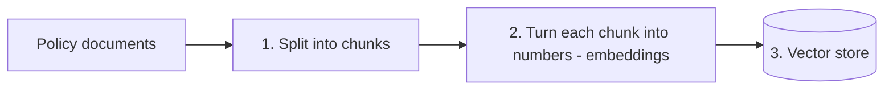

# RAG: answering from your own documents

**RAG = Retrieval-Augmented Generation.** Find the right text first, then let the LLM answer from it.

## The problem

Our return rules are in our own policy documents. The LLM never read them. If we ask "What's your return window?", it gives a generic answer, maybe "30 days". Ours is 10 days.

## Why not paste every document into the prompt?

It works for 5 small documents. It breaks for 5,000. Long prompts are slow, they cost more, and the LLM can miss the important line. So we **search** first and send only the few relevant pieces.

## The RAG pipeline

**Once, at the start (indexing):**

**Every time someone asks (retrieval):**

## The four ideas

| Step | What | Why |
|---|---|---|
| **Chunk** | Cut each document into small pieces (about 600 characters) | Search finds a small, precise piece instead of a whole document |
| **Embed** | Turn each chunk into a list of numbers (a vector) | Texts with similar *meaning* get similar numbers, even with different words |
| **Store** | Keep all vectors in a vector store | Fast "find the closest" search |
| **Retrieve** | Embed the question, find the closest chunks | Give the LLM only what it needs |

Example: "How many days do I have to send something back?" and "Return window: 10 days" share almost no words. Their embeddings are still close, because the meaning is close.

## What makes it *agentic* RAG?

In simple RAG, the code searches before every answer. In **agentic RAG**, search is just another **tool**, `search_policies`. The agent decides *when* to search and *what* to search for. "Where is my order?" needs no policy search. "Can I return my earbuds and how long is the refund?" needs an order lookup *and* a policy search.

## In our project

- 5 policy files in `data/policies/`
- A small free embedding model that runs on your computer: `BAAI/bge-small-en-v1.5`
- LangChain's `InMemoryVectorStore`
- The agent cites the file it used, for example *(source: returns_policy.md)*
