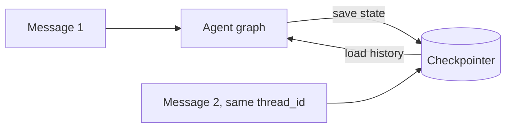
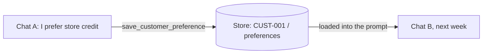

# Memory: short-term and long-term

## The problem

Every time we call the agent, it starts with an empty conversation.

> **Customer:** Where is my order ORD-1003?
> **Agent:** It's delayed by 3 days.
> **Customer:** And when will it arrive?
> **Agent:** Which order do you mean?

The agent forgot the first message.

## Two kinds of memory

| | Short-term memory | Long-term memory |
|---|---|---|
| Remembers | This conversation | Facts about the customer, across all conversations |
| Like | The chat history in one WhatsApp chat | Notes in the customer's file |
| LangGraph piece | **Checkpointer** | **Store** |
| Key | `thread_id` (one per conversation) | Namespace per customer, e.g. `("customers", "CUST-001", "preferences")` |
| Example | "And when will it arrive?" | "I prefer store credit" remembered next week |

## Short-term: the checkpointer

After each step, the checkpointer saves the conversation under its `thread_id`. The next message with the same `thread_id` continues from there. A new `thread_id` starts a new conversation.

One line turns it on: `graph.compile(checkpointer=InMemorySaver())`.

## Long-term: the store

- A tool, `save_customer_preference`, writes the preference to the store.
- On every turn, the agent reads the customer's preferences and adds them to its instructions.

## Safety: whose memory?

The namespace uses the customer id from the **logged-in session**, never from the LLM. So Sam can never read Alex's preferences, even if Sam asks the agent to.

## In our project

We use the in-memory versions (`InMemorySaver`, `InMemoryStore`). They are lost when the notebook restarts. Real apps use a database, such as Postgres, with the same code.
