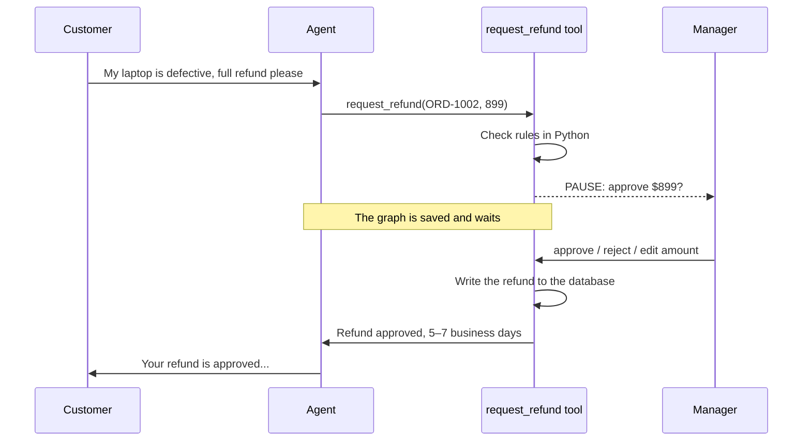

# Human-in-the-loop

## The problem

Now the agent can *do* things, like refund money. Should an AI send \$899 on its own? No. Small refunds can be automatic. Big ones need a person to approve them.

**Our rule:** refunds up to \$100 are automatic. Refunds above \$100 need a manager.

## The idea: pause, ask, continue

## In LangGraph: two pieces

| Piece | What it does |
|---|---|
| `decision = interrupt(payload)` | Pauses the graph and sends `payload` (the refund details) to the outside world |
| `Command(resume=decision)` | Continues the paused graph. `decision` becomes the return value of `interrupt()` |

The pause can last seconds or days. This works because the **checkpointer** saved the graph's state. That's why human-in-the-loop needs memory.

## Three rules we follow

1. **Python checks the rules, not the LLM.** Is the order delivered? Within 10 days? Not refunded already? Amount not above the order total? The tool checks all of this before asking a manager.
2. **Nothing is written before the pause.** When the graph continues, the tool runs again from its first line. If we wrote to the database before `interrupt()`, we would write twice.
3. **No double refunds.** Each tool call has a unique id. The tool uses it as a key, so a retry can't create a second refund.

## The manager's three choices

| Decision | Result |
|---|---|
| `{"action": "approve"}` | Refund processed for the full amount |
| `{"action": "reject", "note": "..."}` | Nothing paid, the agent tells the customer why |
| `{"action": "edit", "amount_usd": 600}` | Refund processed for the new amount |
