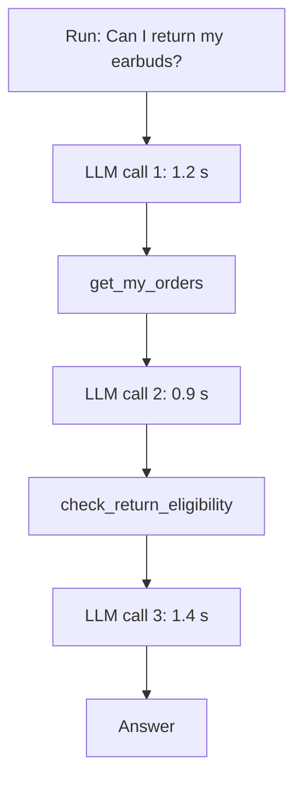
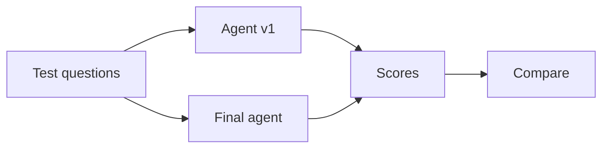

# Observability and evals

## The problem

The agent works in our demo. But:
- When it gives a wrong answer, *which step* went wrong?
- After we change the prompt, is the agent *better or worse*?

## Observability: see inside every run

**Tracing** records every step of every run: each LLM call, each tool call, the inputs, the outputs and the time each took.



We use **LangSmith**. You turn it on with two environment variables. The agent code doesn't change:

```
LANGSMITH_API_KEY=...
LANGSMITH_TRACING=true
```

## Evals: measure, don't guess

An **eval** is a fixed list of test questions with expected results. Run it after every change and compare the scores.



We check three things:

| Check | Question | Graded by |
|---|---|---|
| **Correctness** | Is the answer right? | An LLM judge, compared with a reference answer |
| **Tool selection** | Did it call the right tools? | Code |
| **Refusal** | Did it refuse the attacks, without leaking data? | Code and an LLM judge |

LLM-judged scores change a little between runs. Read them as a guide, not an exact number. Code-graded checks are exact.
